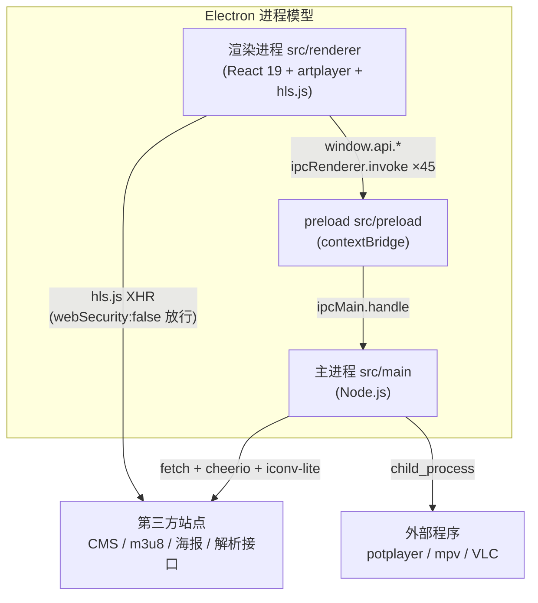
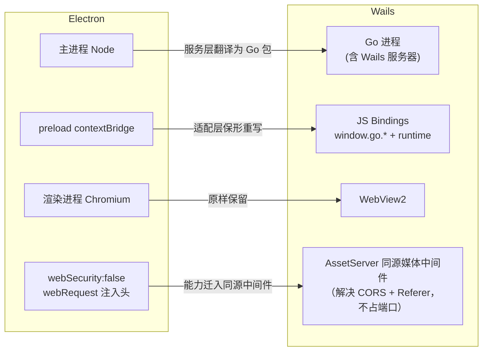
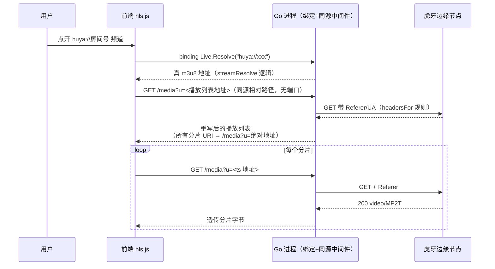
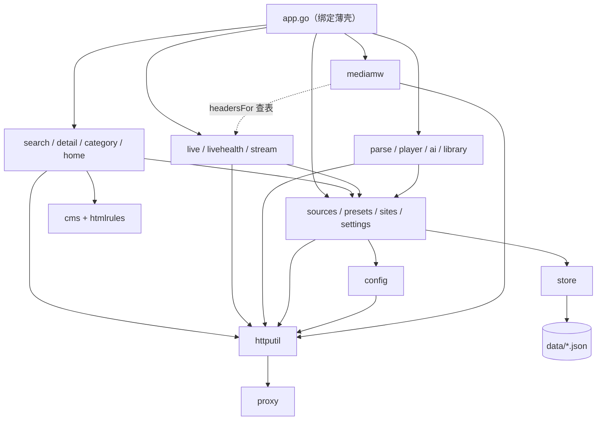

# TVBox Desktop 改造为 Go + Wails 详细方案

- **作者**：Shiro
- **日期**：2026-11-15
- **状态**：设计方案（未实施，本文档不改动任何代码）
- **适用版本**：当前 `tvbox-desktop@0.1.0`（Electron 44 + electron-vite 5 + React 19）

---

## 目录

1. [背景与目标](#1-背景与目标)
2. [现状分析](#2-现状分析)
3. [技术选型结论](#3-技术选型结论)
4. [目标架构](#4-目标架构)
5. [核心难点与解决方案](#5-核心难点与解决方案)
6. [工程目录结构规划](#6-工程目录结构规划)
7. [Go 后端服务层设计](#7-go-后端服务层设计)
8. [IPC 通道 → Wails 绑定映射表](#8-ipc-通道--wails-绑定映射表)
9. [前端改造方案](#9-前端改造方案)
10. [分阶段实施计划](#10-分阶段实施计划)
11. [风险清单与回归测试](#11-风险清单与回归测试)
12. [打包与分发](#12-打包与分发)
13. [验收标准](#13-验收标准)

---

## 1. 背景与目标

### 1.1 背景

当前项目是基于 Electron 的 Windows 影视聚合客户端（TVBox 桌面版）。Electron 形态存在三个长期痛点：

| 痛点 | 现状 | 改造后预期 |
|---|---|---|
| 安装包体积 | Electron 运行时 + Chromium，安装包约 80~200 MB | Go 单二进制 + 系统 WebView2，安装包约 10~25 MB |
| 内存占用 | 主进程 + 渲染进程 + GPU 进程，常驻 300 MB+ | 单进程宿主 + 系统 WebView，常驻 100~180 MB |
| 后端语言栈 | Node/TypeScript，网络/解析逻辑跑在 JS 单线程事件循环上 | Go 原生并发（goroutine），搜索/体检/解析轮询等 IO 密集任务吞吐更好，且可复用团队 Java/Go 后端经验 |

### 1.2 目标

1. **功能等价**：现有 45 个 IPC 通道对应的全部能力（订阅源、站点搜索、详情、分类、直播、解析接口、外部播放器、AI 剧情总结、收藏/历史等）在 Wails 形态下全部可用。
2. **前端零重写**：`src/renderer` 下的 React 页面、组件、zustand store、artplayer/hls.js 播放链路**原样保留**，只替换与桌面宿主交互的适配层。
3. **主进程逻辑平移**：`src/main/services` 下 20 个服务按模块一一对应翻译为 Go 包，业务规则（TVBox 配置协议、CMS 协议、解析协议、虎牙/抖音房间号换址等）逐条保留。
4. **便携形态保留**：数据目录仍然跟随 exe 同级的 `data/`，免安装绿色版形态不变。

### 1.3 非目标

- 不改动 UI 视觉与交互；
- 不引入 macOS / Linux 发行（仍以 Windows 为主要目标，Wails 天然跨平台，留作后续收益）；
- 不升级/重写播放内核（继续用 hls.js + artplayer，WebView2 即 Chromium 内核，兼容性与 Electron 一致）。

---

## 2. 现状分析

### 2.1 现有架构



### 2.2 模块清单

主进程服务层共 **20 个文件、约 3300 行 TypeScript**（详见 [src/main/services](../../src/main/services)），入口 [src/main/index.ts](../../src/main/index.ts) 注册 45 个 `ipcMain.handle`，通道名定义在 [src/shared/ipc.ts](../../src/shared/ipc.ts)，共享类型 530 行定义在 [src/shared/types.ts](../../src/shared/types.ts)。

| 服务文件 | 行数 | 职责 | 依赖的 Node/Electron 能力 |
|---|---|---|---|
| `http.ts` | 133 | 统一网络层：UA/超时/编码嗅探/宽松 JSON | `fetch`、`iconv-lite`（GBK 解码） |
| `cms.ts` | 106 | TVBox CMS 协议：URL 拼装、响应判活 | — |
| `config.ts` | 283 | TVBox 配置 JSON 解析（sites/lives/parses/headers 规则） | `node:fs`、`fetchJson` |
| `sources.ts` | 141 | 订阅源 CRUD + 同步 | `node:crypto.randomUUID` |
| `presets.ts` | 172 | 内置订阅预设 | `node:fs` |
| `sites.ts` | 174 | 站点列表/启停/测活 | `cheerio` |
| `search.ts` | 192 | 多站点并发搜索 + 逐站推送进度 | `cheerio`、回调式流 |
| `detail.ts` | 154 | 详情（CMS + 网页规则双路） | `cheerio` |
| `category.ts` | 487 | 分类树聚合 + 分页浏览 + 缓存 | — |
| `home.ts` | 189 | 首页内容位（推荐/最新）+ 10 分钟缓存 | — |
| `live.ts` | 269 | m3u 直播源解析、分组 | `node:fs` |
| `liveHealth.ts` | 170 | 线路并发体检 + 缓存 | — |
| `streamResolve.ts` | 206 | 虎牙/抖音房间号 → m3u8 换址；`headersFor()` Referer 规则表 | — |
| `library.ts` | 155 | 收藏 / 观看历史 | — |
| `player.ts` | 260 | 外部播放器探测（常见安装路径）与拉起 | `child_process.execFile/spawn` |
| `parse.ts` | 584 | 解析接口轮询、三型响应（302/JSON/网页挖址）、统计 | — |
| `settings.ts` | 37 | 设置读写 | — |
| `store.ts` | 71 | JSON 文件持久化（settings/sources/sites 等） | `electron.app.getPath`、`node:fs` |
| `htmlRules.ts` | 121 | 网页型站点规则抽取（选择器引擎） | `cheerio` |
| `proxy.ts` | 74 | 启动时探测系统代理可达性，不可达则切直连 | `electron.session.resolveProxy`、`node:net` |
| `ai.ts` | 271 | DeepSeek OpenAI 兼容调用（文本 + 多模态帧） | `fetch` |

### 2.3 Electron 专属机制（改造重点）

以下四点是本次改造的**真正难点**，其余均为常规翻译：

1. **`webSecurity: false`**（[main/index.ts#L105](../../src/main/index.ts)）：渲染页面源为 `file://`，hls.js 用 XHR 拉第三方 m3u8 分片会被 CORS 拦截，Electron 靠关掉安全策略放行。Wails 的 WebView2 **无法关闭 CORS**。
2. **`session.webRequest.onBeforeSendHeaders` 注入 Referer**（[main/index.ts#L293](../../src/main/index.ts)）：虎牙/抖音分片校验 Referer，而 `Referer` 是浏览器 forbidden header，hls.js 设不了，只能在会话层补。Wails 没有等价的 webRequest API。
3. **`ensureReachableProxy`**（[services/proxy.ts](../../src/main/services/proxy.ts)）：解决"系统代理开着但代理软件没跑 → Chromium 全站 ERR_PROXY_CONNECTION_FAILED"。依赖 `electron.session`。
4. **主窗口生命周期 / 文件对话框 / shell.openExternal**：`dialog.showOpenDialog`、`shell.openExternal`、窗口尺寸记忆（resize 防抖落盘）。

### 2.4 前端对宿主的依赖面

渲染层通过 `window.api.*` 访问宿主，共 **58 处调用、7 个文件**（集中在 [store/useApp.ts](../../src/renderer/src/store/useApp.ts)、[pages/Settings.tsx](../../src/renderer/src/pages/Settings.tsx)、[pages/Live.tsx](../../src/renderer/src/pages/Live.tsx)）。API 形状定义在 [preload/index.ts](../../src/preload/index.ts) 的 `DesktopApi`。**只要保住 `DesktopApi` 这个形状，前端改动可以收敛到一个适配文件。**

---

## 3. 技术选型结论

| 项 | 选择 | 理由 |
|---|---|---|
| 框架 | **Wails v3**（≥ v3.0.0 stable，建议 v3.1.0） | v3.0.0 已正式发布为桌面稳定版；v3.1.0（2026-11）提供免 CGO 构建与 Wake 打包工具。v2 与 v3 的 API 差异大，新项目直接用 v3，避免二次迁移 |
| Go | **Go 1.26+** | Wails v3 官方要求的最低工具链版本 |
| WebView | Windows 上使用 **WebView2（Chromium）** | 与 Electron 同为 Chromium 内核，artplayer/hls.js/现代 CSS 行为一致，前端零适配成本；Win10/11 系统自带或自动引导安装 |
| 前端构建 | **保留 Vite + React 19**，作为 Wails 的 assets 嵌入 | Wails v3 对任意前端框架提供官方模板，Vite 构建产物由 Go 二进制内嵌（`//go:embed`），不再走 `file://` 而是 `wails://` 自定义协议 |
| HTML 解析 | **goquery**（`github.com/PuerkitoBio/goquery`） | 与 cheerio 同为 jQuery 风格选择器 API，`htmlRules.ts`/`detail.ts`/`search.ts` 的选择器字符串可直接复用 |
| 编码转换 | **`golang.org/x/text/encoding/simplifiedchinese`**（GBK/GB18030）+ `unicode/utf8` 嗅探 | 替代 iconv-lite；CMS 站点常见 GBK/cp936，GB18030 向下兼容 GBK，覆盖面足够 |
| JSON | 标准库 `encoding/json` + 自定义宽松解析 | 替代 `parseLooseJson`；注意 TVBox 协议里字段**数字/字符串混用**（如 `vod_id`、`class` 数组），需 `json.RawMessage` 两段式解析 |
| HTTP | 标准库 `net/http` + 自定义 `Transport` | 统一超时（`context.WithTimeout` 替代 AbortController）、重定向跟随、代理控制 |

> 参考：Wails 官方发布说明与安装要求见文末 Sources 列表。

---

## 4. 目标架构

### 4.1 改造后总体架构

```mermaid
graph TB
    subgraph "单一 Go 进程"
        MAIN["main.go<br/>Wails 应用装配"]
        APP["App 绑定结构体<br/>app.go（45 个方法）"]
        SVC["internal/* 服务层<br/>（20 个包，翻译自 services）"]
        STORE["internal/store<br/>JSON 持久化（data/）"]
        MW["internal/mediamw<br/>★ AssetServer 同源媒体中间件<br/>（不占端口）"]
        WEBVIEW["WebView2 宿主<br/>wails:// 内嵌前端资源"]
    end
    subgraph "前端（不变）"
        RD["React 19 页面/组件<br/>artplayer + hls.js"]
        ADAPTER["api 适配层<br/>DesktopApi 形状不变"]
    end
    NET["第三方站点<br/>CMS / m3u8 / 海报 / 解析"]
    EXT["外部播放器<br/>os/exec"]

    RD -- "window.api.*" --> ADAPTER
    ADAPTER -- "JS Binding 调用" --> APP
    APP -- 函数调用 --> SVC
    ADAPTER -- "EventsOn('search:progress')" -. 事件推送 .-> APP
    SVC -- "net/http + goquery + x/text" --> NET
    RD -- "hls.js /  改指同源 /media?u=" --> MW
    MW -- "注入 Referer/UA + 重写 m3u8 URI" --> NET
    WEBVIEW --- RD
    SVC --> STORE
    APP -- os/exec --> EXT
```

### 4.2 与 Electron 架构的逐项对照



**核心思想**：Electron 里"渲染进程直连第三方站点"的通路（靠关安全策略放行）在 Wails 里**整体收编到 Go 侧**——所有第三方媒体流量改走前端同源路径 `/media?u=...`，由 Wails AssetServer 中间件在 Go 进程内转发，一并解决 CORS、Referer 防盗链、编码、系统代理四个问题，且**进程不监听任何 TCP 端口**。这是与 Electron 最大的架构差异，也是本方案的关键决策。

### 4.3 同源媒体转发时序（直播播放为例）



---

## 5. 核心难点与解决方案

### 5.1 难点一：CORS —— `webSecurity:false` 的替代（关键决策）

**问题**：Wails 前端页面运行在 `wails://`（或内部 localhost）源上，hls.js 的 XHR 拉第三方 m3u8/分片、`` 之外的 fetch 类请求都会被 WebView2 的 CORS 拦截。Electron 用关闭安全策略绕过，Wails 不提供该开关。

**方案：Wails AssetServer 中间件做同源媒体转发（`internal/mediamw`，不占端口）**

Wails 的 AssetServer 官方支持 `assetserver.Middleware` 挂进请求链（见文末 Sources）。页面本身由 AssetServer 经 WebView2 资源拦截在**进程内**提供，不建立 TCP 监听，因此给前端加一条同源路径即可完成媒体转发，全程零端口占用：

- 路由设计（全部是页面同源相对路径，不新增监听）：
  - `GET /media?u=<urlencoded 原始地址>`：中间件识别 `/media` 前缀后，用 Go `net/http` 透传任意第三方资源（m3u8、ts 分片、mp4、海报图），按 `headersFor()` 规则注入 Referer/UA/Origin，支持 Range 请求透传（外部 `<video>` 拖拽需要）。
  - 对 `Content-Type: application/vnd.apple.mpegurl` / `.m3u8` 响应体做 **URI 重写**：把相对/绝对分片地址全部改写为同源 `/media?u=...`，让 hls.js 后续请求天然落在中间件内。
- 前端接入点（改动集中在两处工具文件）：
  - [utils/media.ts](../../src/renderer/src/utils/media.ts) / [utils/artplayer.ts](../../src/renderer/src/utils/artplayer.ts)：播放地址统一过 `toProxyUrl()`（产出**同源相对路径** `/media?u=...`）；
  - [components/Poster.tsx](../../src/renderer/src/components/Poster.tsx) 等海报 ``：`` 本身不受 CORS 限制，**可不改**；但为统一处理防盗链 Referer（部分图床校验 Referer），建议一并走中间件。
- 开发模式说明：`wails3 dev` 下页面源是 Vite dev server（开发期本就占用端口，与现版 `npm run dev` 相同），给 Vite 配置加一条中间件插件把 `/media` 转给 Go 侧即可；**生产运行不监听任何端口**。
- 平台差异与退路：Windows/WebView2 走进程内资源拦截无端口；若个别平台（macOS/Linux）的中间件能力受限，退路见 11.1 R9（hls.js 自定义 loader 经 binding 取字节，同样无端口）。

**收益**：CORS、Referer 注入（难点二）、系统代理（难点三）三个问题被同一个组件收编，且**不新增任何监听端口**，前端不再需要任何"关安全策略"式的特殊豁免。

### 5.2 难点二：Referer 防盗链注入

**问题**：Electron 用 `webRequest.onBeforeSendHeaders` 给虎牙/抖音域名补 Referer（[main/index.ts#L293-L300](../../src/main/index.ts)），因为 `Referer` 是 forbidden header，hls.js 无法自行设置。

**方案**：`streamResolve.ts` 中的 `headersFor(url)` 规则表**原样翻译为 Go**（`internal/stream` 包导出），由 5.1 的同源中间件在转发前查表注入。规则只按域名后缀匹配（虎牙会把域名改写进 path，逻辑保留原注释里的坑位说明）。前端不再需要任何 header 注入能力。

### 5.3 难点三：系统代理可达性探测

**问题**：[services/proxy.ts](../../src/main/services/proxy.ts) 依赖 `electron.session.resolveProxy`。

**方案**：职责拆分——
1. **Go 出站流量**（搜索/详情/解析等，占绝大多数）：`net/http` 默认 `http.ProxyFromEnvironment`；启动时用 Go 重写"探测代理端口 TCP 可达性，不可达则 Transport 强制 `Proxy=nil` 直连"，逻辑与现版一致（`net.Dialer` 800ms 超时）。Windows 下系统代理从注册表 `Internet Settings` 或 `winhttp` 读取，封装成 `internal/proxy`。
2. **WebView 流量**：媒体流量已全部走同源 `/media` 中间件，WebView 不再直连第三方，Chromium 代理故障面基本消除，无需等价机制。

### 5.4 难点四：事件推送（search:progress）

**问题**：Electron 主进程通过 `webContents.send` 逐站推送搜索进度。

**方案**：Wails v3 内置事件系统。Go 侧 `runtime.EventsEmit(ctx, "search:progress", payload)`，前端 `@wailsio/runtime` 的 `EventsOn('search:progress', cb)`。`searchAll` 的回调式接口改为 goroutine + channel 聚合，取消搜索用 `context.CancelFunc`（对应现有 `cancelSearch()`，全局保存一个可取消的 search context）。

### 5.5 难点五：窗口/对话框/外链等宿主能力

| Electron 能力 | Wails v3 对应 |
|---|---|
| `dialog.showOpenDialog`（选 JSON 文件） | `runtime.OpenFileDialog`（v3 官方文件对话框 API） |
| `shell.openExternal` | `runtime.BrowserOpenURL` |
| BrowserWindow 尺寸/最小尺寸/白底防闪 | `app.Options` 的 `Window.New(...)`：`Width/Height/MinWidth/MinHeight/BackgroundColour` |
| resize 防抖 400ms 记忆窗口 | 监听 `WindowEvents.Resized` → Go 侧防抖落盘 settings（现有逻辑平移） |
| `app.setPath('userData', data/)` 便携目录 | Go：`filepath.Join(filepath.Dir(os.Executable()), "data")`；`store.ts` 翻译时以此为根 |
| 单实例 | Wails v3 内置 single-instance 选项，开启即可（Electron 版未显式处理，属顺带增强） |
| `before-quit` flushStore | `OnShutdown` 钩子调用 `store.Flush()` |

### 5.6 难点六：cheerio/iconv-lite 等 JS 库的 Go 等价物

| 现依赖 | 用途 | Go 替代 | 差异与对策 |
|---|---|---|---|
| `cheerio` | sites/detail/search/htmlRules 的选择器抽取 | `goquery` | API 高度同构；注意 cheerio 的 `.text()` 空白规整与 goquery 略有差异，回归时重点比对海报图/简介字段抽取结果 |
| `iconv-lite` | GBK/cp936/GB2312 解码 | `x/text/encoding/simplifiedchinese` | GB18030 超集解码可覆盖；`detectEncoding` 的 header/meta/xml 三级嗅探逻辑逐行平移 |
| Node `fetch` + AbortController | 统一超时 | `http.Client` + `context` | 超时语义等价；`allowHttpError`（500 也带数据）用 `resp.StatusCode` 分支保留 |
| `JSON.parse` 容错 | BOM/截取花括号兜底 | `encoding/json` + 手写 `ParseLooseJSON` | 保留"剥 BOM → 直接解析 → 截取首个 `{` 到末个 `}`"三段兜底；数字/字符串混用字段统一按 `json.RawMessage` 收，再按目标类型宽松转换（对应现有 `asArray` 等工具） |
| `node:crypto.randomUUID` | 订阅源 id | `github.com/google/uuid` | 无差异 |
| `child_process` | 外部播放器探测/拉起 | `os/exec` | 探测路径表、`DETACHED` 语义（`SysProcAttr{CreationFlags: CREATE_NEW_PROCESS_GROUP}`）平移 |
| `node:net` | 代理端口连通探测 | `net.DialTimeout` | 无差异 |

### 5.7 注意点：AI 多模态帧传输

现有链路：渲染进程 `<video>` 抽帧（[utils/frames.ts](../../src/renderer/src/utils/frames.ts)）→ IPC 传 base64 数组 → 主进程拼 OpenAI 兼容请求。Wails 的 binding 对大 payload（140 帧 base64 可能达数 MB）走 JSON 序列化，**性能可接受但建议**：抽帧上限与压缩质量沿用现值（`MAX_FRAMES=140`），并实测一次视觉总结的端到端耗时；若 binding 传输成为瓶颈，退路是抽帧结果先 POST 到同源中间件新增的 `POST /ai-frames` 暂存路径，binding 只传句柄。

---

## 6. 工程目录结构规划

在原仓库内新建 `wails-app/` 目录并行孵化，前端从 `src/renderer` 复制迁移，Electron 代码保留至验收通过后再删除：

```
tvbox-desktop/
├── wails-app/                        # ★ 新形态根目录
│   ├── go.mod                        # module tvbox-desktop; go 1.26
│   ├── main.go                       # Wails 装配：窗口/钩子/绑定/AssetServer 中间件注册
│   ├── app.go                        # App 结构体：45 个绑定方法（薄壳，转发 internal/*）
│   ├── events.go                     # 事件名常量（search:progress 等）
│   ├── internal/
│   │   ├── httputil/                 # ← services/http.ts
│   │   ├── store/                    # ← services/store.ts
│   │   ├── settings/                 # ← services/settings.ts
│   │   ├── proxy/                    # ← services/proxy.ts
│   │   ├── mediamw/                  # ★ 新增：AssetServer 同源媒体中间件（不占端口）
│   │   ├── cms/                      # ← services/cms.ts
│   │   ├── config/                   # ← services/config.ts
│   │   ├── htmlrules/                # ← services/htmlRules.ts
│   │   ├── sources/                  # ← services/sources.ts
│   │   ├── presets/                  # ← services/presets.ts
│   │   ├── sites/                    # ← services/sites.ts
│   │   ├── search/                   # ← services/search.ts
│   │   ├── detail/                   # ← services/detail.ts
│   │   ├── category/                 # ← services/category.ts
│   │   ├── home/                     # ← services/home.ts
│   │   ├── live/                     # ← services/live.ts
│   │   ├── livehealth/               # ← services/liveHealth.ts
│   │   ├── stream/                   # ← services/streamResolve.ts（含 headersFor）
│   │   ├── library/                  # ← services/library.ts
│   │   ├── player/                   # ← services/player.ts
│   │   ├── parse/                    # ← services/parse.ts
│   │   └── ai/                       # ← services/ai.ts
│   ├── models/                       # 共享类型（← shared/types.ts 的 Go struct）
│   └── frontend/                     # ← 原 src/renderer + src/shared
│       ├── package.json              # 去掉 electron 相关，加 @wailsio/runtime
│       ├── vite.config.ts
│       └── src/
│           ├── api/                  # ★ 新增：DesktopApi 保形适配层
│           ├── pages/ components/ store/ styles/ utils/   # 原样迁移
│           └── shared/               # types.ts / ipc.ts(事件名) / liveUrl.ts / siteLabels.ts
├── src/                              # Electron 旧形态（验收后移除）
└── .trae/documents/                  # 本文档
```

要点：
- `data/` 便携目录、`settings.json`/`sources.json`/`sites.json` 等**文件格式完全不变**，两代程序可互读，升级/回滚零成本；
- `models/` 与 `frontend/src/shared/types.ts` 双向对齐：以 TS 类型为基准手写 Go struct（字段用 `json` tag 对齐），后期可用 `wails3 task generate:models` 由 Go 生成 TS 声明做校验。

---

## 7. Go 后端服务层设计

### 7.1 包依赖分层



依赖方向与现有 TS 完全一致（`sources ← live/category/home` 单向，避免环）；`clearLiveCache/clearCategoryCache/clearHomeCache` 的"订阅源变更即失效"联动从 `index.ts` 挪到 `app.go` 的 SourcesAdd/Update/Remove/Sync 方法里，位置不同、语义相同。

### 7.2 关键类型映射（节选）

| TS（shared/types.ts） | Go（models/） | 说明 |
|---|---|---|
| `AppSettings` | `type AppSettings struct{...}` | `window{width,height}` → `WindowBounds` |
| `ConfigSource` / `ParsedConfig` | `ConfigSource` / `ParsedConfig` | `sites`/`lives`/`parses` 数组元素含混型字段，统一 `[]map[string]any` + 宽松取值函数（对应 `asArray`） |
| `Vod` / `Episode` / `Line` / `VodDetail` | 同名 struct | `json` tag 保留 CMS 原始字段名（`vod_id`/`vod_name`…） |
| `SearchProgress` | `SearchProgress` | 事件负载 |
| `LiveHealth` / `PlayerInfo` / `ParseInfo` / `ParseResult` / `AiSummaryInput` / `AiFrame` | 同名 struct | — |

命名规则：Go 导出类型用大驼峰，`json` tag 保持原样，因此序列化给前端的字段名**不变**，前端类型定义无需改名。

### 7.3 并发模型

| 场景 | 现有实现 | Go 实现 |
|---|---|---|
| 多站点搜索 | Promise 池 + 逐站回调 | 每站点一个 goroutine，`sync.WaitGroup` 收敛；进度经 `EventsEmit`；全局 `atomic.Value` 存 `context.CancelFunc` 实现 `SearchCancel` |
| 直播线路体检 | 并发 fetch + 超时 | `errgroup.WithContext` + 信号量限并发（沿用现有并发上限值） |
| 解析接口轮询 | 预算 24s、单接口 8s | 同上，预算用 `context.WithTimeout`，先到先得用 channel 竞争 |
| store 写盘 | Node 单线程天然安全 | **加锁**：`store` 包内 `sync.Mutex` + 防抖落盘（现有 flush 语义保留），这是翻译时唯一必须新增的同步设计 |

---

## 8. IPC 通道 → Wails 绑定映射表

Wails v3 绑定采用**按领域分组的结构体**（一个领域一个 `*Service`，注册后前端经 `window.go.tvbox.<领域>.<方法>` 调用），避免 45 个方法堆在一个 `App` 上。完整映射：

| 领域绑定 | 原 IPC 通道 | Go 方法（签名要点） |
|---|---|---|
| App | `app:info` | `Info() models.AppInfo`（version/go/webview/数据目录） |
| App | `app:open-external` | `OpenExternal(url string)`（校验 http/https 后 `BrowserOpenURL`） |
| Settings | `settings:get` / `settings:set` | `Get()` / `Set(patch map[string]any)` |
| Sources | `sources:list/add/update/remove/sync/sync-all/presets/add-preset` | `List/Add/Update/Remove/Sync/SyncAll/Presets/AddPreset`（Add/Update/Remove/Sync* 内部联动清缓存） |
| Sources | `sources:pick-file` | `PickFile() (string, error)`（`OpenFileDialog` + json 过滤器） |
| Sites | `sites:list/set-enabled/set-all-enabled/test` | `List/SetEnabled/SetAllEnabled/Test` |
| Search | `search:run` / `search:cancel` | `Run(wd string, opts models.SearchOptions)`；进度经事件 `search:progress`；`Cancel()` |
| Detail | `detail:get` | `Get(siteKey, vodID string)` |
| Category | `category:list/browse` | `List/Browse` |
| Live | `live:load/resolve/health/probe/clear-health` | `Load/Resolve/Health/Probe/ClearHealth` |
| Library | `library:get/toggle-favorite/remove-favorite/clear-favorites/record/remove-history/clear-history` | `Get/ToggleFavorite/RemoveFavorite/ClearFavorites/Record/RemoveHistory/ClearHistory` |
| Player | `player:detect/open` | `Detect/Open` |
| Parse | `parse:list/resolve/test/add/remove/reset-stats` | `List/Resolve/Test/Add/Remove/ResetStats` |
| Home | `home:sections` | `Sections(force bool)` |
| Ai | `ai:summary` / `ai:summary-visual` | `Summarize(input)` / `SummarizeVisual(input, frames []models.AiFrame)` |
| Media（新增） | — | **无绑定方法、无端口**；媒体经同源 `/media` 中间件路径访问（见 5.1） |

事件通道（Go → 前端）：仅 `search:progress` 一个，与现版一致。

---

## 9. 前端改造方案

### 9.1 DesktopApi 保形适配层（改动收敛点）

新建 `frontend/src/api/index.ts`，**导出与 `DesktopApi` 完全同构的对象**，内部改为 Wails 调用；在 `main.tsx` 挂载前 `window.api = api`（或直接改 import，见 9.2）：

```typescript
// frontend/src/api/index.ts（示意，作者 Shiro）
import { EventsOn } from '@wailsio/runtime'
import * as go from '../../wailsjs/go/tvbox'   // wails3 生成的绑定

export const api = {
  info: () => go.App.Info(),
  openExternal: (url: string) => go.App.OpenExternal(url),
  settings: {
    get: () => go.Settings.Get(),
    set: (patch) => go.Settings.Set(patch)
  },
  search: {
    run: (wd, options) => go.Search.Run(wd, options ?? {}),
    cancel: () => go.Search.Cancel(),
    onProgress: (cb) => {
      const off = EventsOn('search:progress', cb)   // 返回取消订阅，形状同 preload 版
      return () => off()
    }
  },
  // ...其余领域一一对应，共 45 个方法
}
```

**策略决策**：58 处调用点分布在 7 个文件，全部是 `window.api.xxx()` 形式。适配层同时把对象赋回 `window.api`，则**页面/组件/store 一行不用改**；`global.d.ts` 里的 `DesktopApi` 类型声明直接复用。

### 9.2 必须改动的前端文件（除适配层外仅 4 处）

| 文件 | 改动 | 原因 |
|---|---|---|
| `utils/media.ts` | 新增 `toProxyUrl(u)`：http(s) 媒体/海报地址改写为**同源相对路径** `/media?u=...`（不涉端口） | 5.1 中间件接入 |
| `utils/artplayer.ts` / `pages/Player.tsx` | 创建播放器前对播放地址调用 `toProxyUrl` | 同上 |
| `pages/Live.tsx` | 直播播放地址同样过 `toProxyUrl` | 同上 |
| `main.tsx` | 引入并挂载适配层；删除 Electron 环境假设 | 宿主切换 |

不改动：所有页面 UI、zustand store、样式、artplayer/hls.js 配置本身、`shared/types.ts`。

### 9.3 开发模式

`wails3 dev`（Wake）自动跑 Vite dev server + 热重载 + Go 重编译，对应现有 `npm run dev`；`ELECTRON_RENDERER_URL` 分支逻辑删除（Wails 自动处理 dev URL 与内嵌资源切换）。

---

## 10. 分阶段实施计划


| 阶段 | 内容 | 产出/退出条件 |
|---|---|---|
| 0 | `wails3 init` 建 `wails-app/`；迁移前端壳；**先做 mediamw 同源中间件 PoC**：一条虎牙房间直播 + 一个 GBK 站点海报，验证 CORS/Referer/编码三件套 | PoC 能出画面、无 403/乱码，且 `netstat -ano` 确认本进程无任何 LISTEN 端口，判定架构成立 |
| 1 | 基座四件：`store`（含互斥锁与防抖落盘）、`settings`、`httputil`（含 `ParseLooseJSON`/编码嗅探）、`proxy`；`models` 全量类型 | 单测：store 读写并发安全、GBK/宽松 JSON 用例集通过 |
| 2 | `cms/config/sources/presets/sites/htmlrules/search/detail/category/home`；`app.go` 对应绑定；事件推送 | 订阅→站点列表→搜索出结果→详情→分类浏览全链路可用，结果与 Electron 版逐站 diff |
| 3 | `live/livehealth/stream/parse` + `mediamw` 完整实现（Range 透传、m3u8 URI 重写） | 直播分组/体检/播放、解析接口轮询换址可用 |
| 4 | `library/player/ai` + 窗口尺寸记忆 + 文件对话框 + 外链 | 收藏/历史、外部播放器拉起、AI 总结（含视觉）可用 |
| 5 | 前端适配层全量接线（9.1/9.2），删除 Electron 专属分支 | 58 处调用零改动的验证报告；全功能手工冒烟 |
| 6 | NSIS 安装包、体积/内存对比表、回归清单（11.2）执行、旧 `src/` 归档删除 | 验收标准（第 13 节）全部达成 |

> 阶段 2~4 的 internal 包之间无强耦合，可按包并行翻译；每包交付时附带从 `功能框架.txt` 与现有注释里提炼的业务规则清单，防止规则漏译。

---

## 11. 风险清单与回归测试

### 11.1 风险与对策

| # | 风险 | 概率 | 影响 | 对策 |
|---|---|---|---|---|
| R1 | WebView2 运行时在精简系统/旧 Windows 缺失 | 低 | 启动白屏 | 打包启用 Wails 官方 WebView2 bootstrapper；安装时检测 |
| R2 | goquery 与 cheerio 选择器/文本规整差异导致字段抽取不一致 | 中 | 个别站点详情缺字段 | 阶段 2 建立"双跑对比"脚本：同一站点同一 id 两版输出 diff；差异集中在 `htmlrules` 的取值函数层修 |
| R3 | 中间件转发成为分片吞吐瓶颈 | 低 | 卡顿 | Go `io.Copy` 流式透传 + 连接复用；进程内转发无网络回环开销，PoC 阶段实测 4K 流 |
| R4 | binding 大 payload（AI 140 帧）序列化慢 | 中 | AI 总结等待变长 | 5.7 退路：同源中间件 `/ai-frames` 暂存路径传句柄 |
| R5 | m3u8 变体（master playlist）改写复杂（虎牙边缘 IP 403 历史坑） | 中 | 直播个别线路黑屏 | 保留 `streamResolve` "优先 media、master 兜底"策略；中间件对 master 的 `EXT-X-STREAM-INF` URI 同样改写 |
| R6 | Wails v3 小版本 API 抖动（v3.0→v3.1 周更节奏） | 中 | 升级成本 | 锁定 v3.1.x；绑定层薄壳隔离，框架 API 只出现在 `main.go/app.go` |
| R7 | GBK 站点实际为 GB18030 生僻字/双重编码 | 低 | 简介乱码 | 解码统一走 GB18030（GBK 超集），保留 forced encoding 设置项 |
| R8 | 数据目录在 `Program Files` 下只读（现版便携形态未遇到） | 低 | 无法落盘 | 保留现版"建不出来就退默认目录"的兜底逻辑，Go 侧同实现 |
| R9 | AssetServer 中间件对 `http.Request` 的能力矩阵限制（个别平台 POST body / Range / 流式响应不完整） | 低 | 拖拽/投屏异常 | 按官方功能矩阵核对 Range 与流式透传；受限平台退路：hls.js 自定义 loader 经 binding 取分片字节（`Media.Fetch(url) []byte`），同样不占端口 |

### 11.2 回归测试清单（阶段 6 执行）

1. **升级兼容**：用 Electron 版产生的 `data/` 目录直接启动 Wails 版，设置/订阅/收藏/历史完整读出；
2. **搜索**：≥3 个 CMS 站 + ≥1 个网页规则站，逐站进度流式渲染、中途取消、再搜索；
3. **详情/播放**：直链、解析接口换址、外部播放器拉起三条路径；
4. **直播**：普通 m3u、huya:// 房间号、douyin:// 房间号，切分组预热体检、坏线标记；
5. **编码**：一个 GBK 站点搜索+详情无乱码；
6. **代理**：开启系统代理但代理软件未运行时全功能正常（对应 proxy.ts 场景）；
7. **窗口**：尺寸记忆、最小尺寸、外链跳系统浏览器；
8. **AI**：文本总结 + 视觉总结（140 帧上限）端到端；
9. **性能**：安装包体积、冷启动时间、播放 10 分钟常驻内存三项对比 Electron 版记录成表。

---

## 12. 打包与分发

| 项 | Electron 现版 | Wails 版 |
|---|---|---|
| 工具链 | electron-builder（[electron-builder.yml](../../electron-builder.yml)） | `wails3 package` / Wake，Windows NSIS 模板 |
| 产物 | 安装目录 + win-unpacked，~150 MB | 单 exe（内嵌前端资源）+ NSIS 安装包，预计 15~25 MB |
| 便携形态 | exe 同级 `data/` | 不变（Go 取 `os.Executable()` 目录） |
| 图标/元数据 | electron-builder 配置 | `wails-app/build/windows/info.json` + `.ico`，沿用现图标资源 |
| CI | 现有 `scripts/` 保留 npm 部分，新增 `go build`/`wails3 task package` | — |
| 代码签名 | 现版未做 | 建议借 Wake 一并补齐（可选） |

`package.json` 的 `build:win` 脚本替换为 `wails3 task package -productname "TVBox Desktop" -nsis`；`electron.vite.config.ts`、`src/main`、`src/preload` 在阶段 6 验收后删除。

---

## 13. 验收标准

1. 功能：第 11.2 回归清单 9 项全通过，无 Electron 版可用而 Wails 版不可用的功能；
2. 兼容：`data/` 目录两代格式互认，老用户升级不丢配置；
3. 前端改动量：除 `api/` 适配层与 9.2 表中 4 个文件外，`pages/components/store/styles` 零 diff；
4. 体积：安装包 ≤ 30 MB；常驻内存较 Electron 版下降 ≥ 40%；
5. 代码规范：Go 侧遵循阿里巴巴编码规范（Java 规范映射到 Go 的等价条款：注释用中文文档注释、错误不忽略、包名小写）、禁止 `import *` 语义的 dot-import、新增依赖仅限 goquery / x/text / uuid；
6. 端口：生产运行全程不监听任何 TCP 端口（启动后 `netstat -ano` 无本进程 LISTEN 项），媒体转发全部经由同源 `/media` 中间件在进程内完成；
7. 回滚：阶段 6 前 `src/` 原样保留，任一阶段失败可退回 Electron 形态继续发版。

---

## Sources

- [Wails v3.0.0 Released · Wails Blog](https://wails.io/blog/wails-v3-released/)
- [Roadmap · Wails（v3.0.0 Stable 状态页）](https://v3.wails.io/status/)
- [Blog · Wails（v3.1.0：CGO-free builds 与 Wake）](https://wails.io/blog/)
- [FAQ · Wails（v3 生产可用性说明）](https://v3.wails.io/faq/)
- [Installation · Wails（Go 1.26+ 要求）](https://v3.wails.io/quick-start/installation/)
- [Creating Custom Transport Layer · Wails（AssetServer/Transport 扩展点）](https://v3.wails.io/guides/custom-transport/)
- [选项 · Wails 框架参考（AssetServer 支持 Middleware 挂接请求链）](https://wails.golang.ac.cn/docs/reference/options/)
