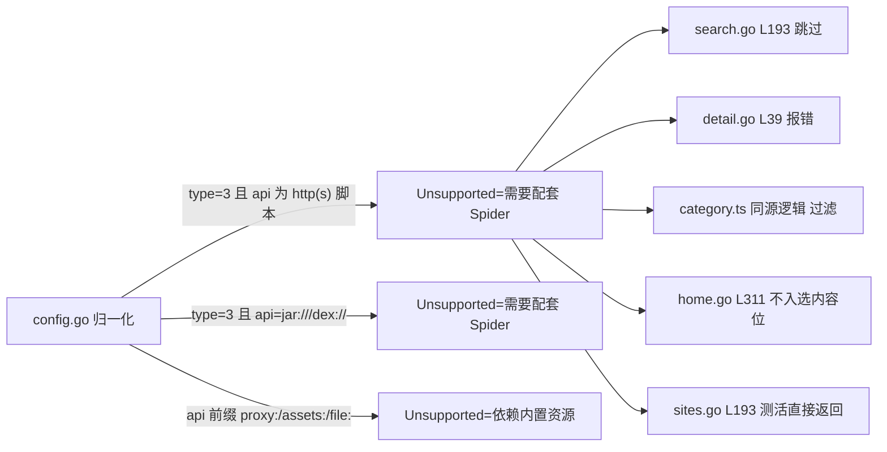
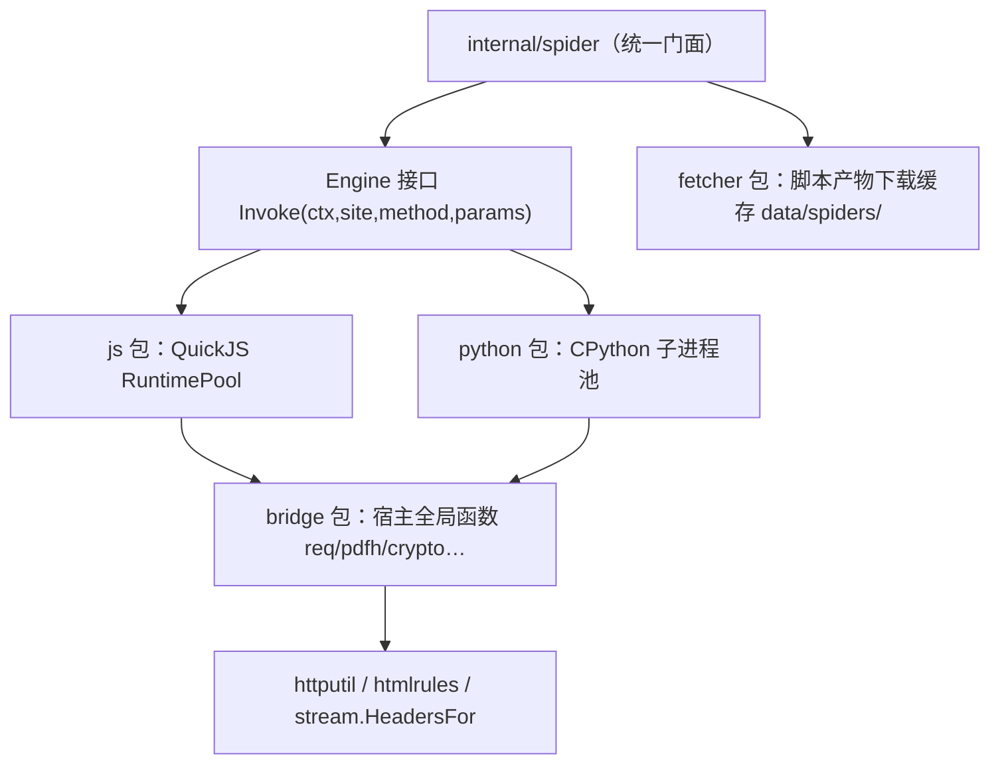
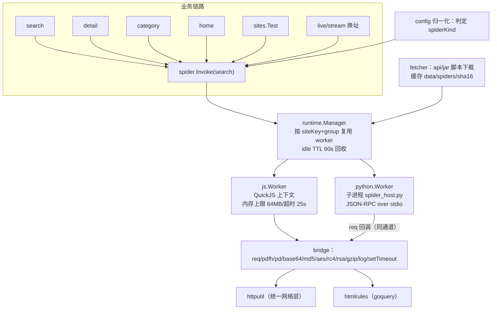
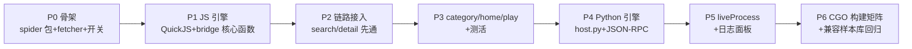

# JS / Python 爬虫（Spider）支持开发设计文档

- **作者**：Shiro
- **日期**：2026-11-20
- **状态**：开发设计（本文档不改动任何代码）
- **前置**：[Electron项目改造Go-Wails详细方案.md](./Electron项目改造Go-Wails详细方案.md)（Go + Wails v3 形态已落地于 [wails-app/](../../wails-app)）

---

## 目录

1. [背景与目标](#1-背景与目标)
2. [现状分析](#2-现状分析)
3. [TVBox Spider 协议调研](#3-tvbox-spider-协议调研)
4. [引擎选型结论](#4-引擎选型结论)
5. [总体架构](#5-总体架构)
6. [模块详细设计](#6-模块详细设计)
7. [与现有链路的集成改造点](#7-与现有链路的集成改造点)
8. [配置与前端交互设计](#8-配置与前端交互设计)
9. [安全设计](#9-安全设计)
10. [分阶段实施计划](#10-分阶段实施计划)
11. [风险清单与回归测试](#11-风险清单与回归测试)
12. [验收标准](#12-验收标准)

---

## 1. 背景与目标

### 1.1 背景

TVBox 生态中大量高质量资源以 **Spider 脚本**形式存在：订阅配置里 `type=3` 的站点，其 `api` 字段指向一段 JS 或 Python 脚本（俗称"猫源"、"py转发"），由宿主 App 内置的脚本引擎执行，产出首页/分类/搜索/详情/播放地址等结构化数据。

当前 Go + Wails 形态与 Electron 版行为一致：这类站点在归一化阶段被统一标记为 `unsupported`（[config.go#L385-L394](../../wails-app/internal/config/config.go)），搜索、详情、分类、首页、测活五条链路全部跳过（[search.go#L193](../../wails-app/internal/search/search.go)、[detail.go#L39](../../wails-app/internal/detail/detail.go) 等），**订阅源里 Spider 站点占比越高，可用资源越少**。

### 1.2 目标

1. 支持在 Go 宿主内执行 **JS Spider**（QuickJS 语义的 TVBox JS 协议，含 async/await）；
2. 支持 **Python Spider**（CPython 子进程 + stdio JSON-RPC，覆盖 py 转发协议）；
3. Spider 站点接入现有五条业务链路（搜索/详情/分类/首页/测活）与直播 `liveProcess`；
4. 无法运行的形态（`jar://`/`dex://` Android 编译产物、`proxy:`/`assets:` 本地资源依赖）保持现状显式标灰，**不假装支持**；
5. 脚本执行默认关闭，用户显式开启后生效（安全门槛，见第 9 节）。

### 1.3 非目标

- 不实现 Android DEX/JAR Spider（需 JVM/ART，超出桌面端合理成本，永久不支持）；
- 不实现 `proxy:`/`assets:`/`file:` 协议依赖的内置资源站点（无对应资源包）；
- 不承诺 100% 猫协议兼容——以"主流猫源样本可跑通"为验收口径（见 11.2）。

---

## 2. 现状分析

### 2.1 数据通路现状



### 2.2 已具备的复用条件

| 既有能力 | 所在包 | Spider 复用方式 |
|---|---|---|
| 统一网络层（GBK 嗅探/宽松 JSON/超时/代理开关） | `internal/httputil` | 脚本 `req()` 桥直接调用，行为与主进程一致 |
| Referer/UA 注入规则表 | `internal/stream.HeadersFor` | `req()` 桥自动套用 |
| goquery 选择器抽取 | `internal/htmlrules` | 猫协议 `pdfh()` 系列全局函数的底层实现 |
| 同源媒体中间件（不占端口） | `internal/mediamw` | 脚本产出的 m3u8/ts 播放地址无需改动即走同源转发 |
| 解析接口换址（302/JSON/网页挖址） | `internal/parse` | Spider `play()` 返回的转发地址可再走 parse 兜底 |
| JSON 文件存储 + 防抖落盘 | `internal/store` | Spider 产物缓存、战绩统计沿用 |

### 2.3 站点字段可用性

[models.Site](../../wails-app/models/models.go) 已保留执行所需全部输入：`Type`（3=Spider）、`API`（脚本地址或内联代码）、`Ext`（站点参数，字符串或对象 JSON 串）、`Jar`（全局脚本地址）、`Header`、`Timeout`、`Filterable`、`Searchable`。归一化时 `spider`/`jar` 别名已进 `typeAlias` 表（[config.go#L38-L39](../../wails-app/internal/config/config.go)）。

---

## 3. TVBox Spider 协议调研

### 3.1 JS Spider（猫协议）形态

事实标准来自 TVBox Android 内置 QuickJS 宿主 + "猫"公共库，脚本约定：

```javascript
// 站点 api 指向的 .js 文件典型结构（简化）
async function main(input) {          // 统一入口，input 为 JSON 字符串
  const j = JSON.parse(input)
  switch (j.type) {
    case 'init':     init(j.ext, j.group); break
    case 'home':     return home(j)
    case 'cateList': return category(j)
    case 'detail':   return detail(j)
    case 'search':   return search(j.wd, j.quick)
    case 'play':     return play(j.url, j.jid)
    case 'live':     return liveProcess(j.manual, j.url)
  }
}
// 脚本内可使用的宿主全局函数（由宿主注入）：
// req(url, options) / pdfh(html, rule) / pd(html, rule) / base64Encode / md5 / aesEncode
// rc4 / rsa / gzip / urlencode / getProxyUrl / log / setTimeout / Date / crypto 等
```

关键事实（决定选型）：

1. **必须支持 async/await**：主流猫源几乎全部是异步写法；
2. **必须提供宿主全局函数集**（req/pdfh/加解密族），脚本不依赖 npm——这是"宿主兼容层"工作量所在，而非 JS 引擎本身；
3. `ext` 参数按站点注入 `init()`，`group` 用于多站共享一个脚本文件时的分组隔离；
4. 返回值形态：`home` 返回含 `list`/`class`/`filters` 的 JSON 串；`search` 返回苹果CMS 风格 `{class, list}`；`play` 返回 `{url, header, parse}`。

### 3.2 Python Spider 形态

1. 配置写法：`api` 指向 `.py` 文件，或 `py:` 前缀 + 脚本地址；
2. 约定类协议（py 转发）：脚本内定义 `spider` 类，方法名与 JS 对齐（`init/home/category/detail/search/play/liveProcess`），依赖 `requests`/`httpx`；
3. 部分脚本直接暴露模块级 `main(input)` 与 JS 同构；
4. Python 脚本依赖第三方库 → 需要虚拟环境或"依赖自检 + 提示安装"策略。

### 3.3 统一入口模型

两类脚本可归一为同一个调用面：

```
Invoke(site, method, params) → JSON 字符串结果
method ∈ { init, home, homeVod, category, detail, search, play, live }
```

---

## 4. 引擎选型结论

| 方案 | ES 支持 | async | CGO | 部署依赖 | 结论 |
|---|---|---|---|---|---|
| **goja**（纯 Go） | ES5.1 + 部分 ES6 | ❌ 不支持 | 无 | 无 | ❌ 一票否决：主流猫源全异步 |
| **QuickJS 内嵌**（quickjs-go） | ES2020 完整 | ✅ | 需要 | 无（随 exe） | ✅ **JS 主引擎** |
| Node.js 子进程 | 完整 | ✅ | 无 | 需装/捆绑 Node（~30MB） | 备选（CI 无法出 CGO 产物时降级用） |
| **CPython 子进程 + stdio JSON-RPC** | — | ✅ | 无 | 系统 Python 或可选便携版 | ✅ **Python 主方案**（进程隔离，崩溃不伤主程序） |
| Go 内嵌 Python（go-python3） | — | — | 需要 | 链接 libpython，交叉编译地狱 | ❌ |

**决策**：

- **JS → QuickJS 内嵌**（`github.com/quickjs-go/quickjs-go`，MIT，CGO）。与 Android TVBox 同为 QuickJS 语义，兼容性天花板最高；无外部运行时依赖，符合便携形态。代价是发布产物需 CGO 交叉编译（mingw-w64），见风险 R1 的退路。
- **Python → 子进程 stdio JSON-RPC**。宿主脚本 [data/pyhost/spider_host.py] 常驻复用（按解释器+脚本哈希分组），`req()` 等网络操作**回调 Go 侧**执行（统一代理/UA/超时/编码），脚本退出即回收。Python 缺失时功能整体降级为"提示安装"，不强捆绑。



---

## 5. 总体架构



要点：

1. **门面单点**：业务链路只依赖 `spider.Invoke`，不感知引擎差异；
2. **worker 复用**：`init()` 只跑一次/组，脚本上下文常驻池，按 `siteKey::group::extHash` 键控，空闲 60s 自动销毁（QuickJS 上下文销毁即释放内存，Python 进程 terminate）；
3. **网络统一走桥**：脚本内所有 HTTP 最终落到 `httputil`，因此代理开关、UA、GBK、Referer 规则、超时语义与主进程完全一致，媒体地址天然享受 `/media` 中间件；
4. **失败即降级**：Invoke 返回错误时，调用方按现有 unsupported 路径处理（搜索显示该站失败原因、测活显示错误），不影响其它站点。

---

## 6. 模块详细设计

### 6.1 包结构（新增）

```
wails-app/internal/spider/
├── spider.go        # 门面：Invoke / 可用性判定 / 错误分类
├── engine.go        # Engine 接口 + worker 池 Manager
├── fetcher.go       # 脚本产物获取：http(s) 下载、内联代码、缓存与失效
├── params.go        # 方法参数编组（与 TVBox input JSON 对齐）
├── js/
│   ├── runtime.go   # QuickJS 上下文封装（CGO）
│   ├── host.js      # 宿主兼容层（Promise/定时器/全局函数转发）
│   └── result.go    # 返回值解析（home/category/detail/search/play）
├── python/
│   ├── worker.go    # 子进程生命周期 + JSON-RPC 客户端
│   └── host.py      # 宿主脚本：spider 类加载、req 回调、超时看门狗
└── bridge/
    ├── req.go       # req(url, opts)：method/headers/body/timeout/binary→base64
    ├── html.go      # pdfh/pd：委托 htmlrules 选择器引擎
    ├── crypto.go    # md5/sha1/sha256/base64/hex/aes/des/rc4/rsa
    └── util.go      # gzip/zlib/urlencode/时间戳/log（经事件推前端控制台）
```

### 6.2 核心接口

```go
// Engine 一个脚本运行时。实现：js.Worker / python.Worker。
type Engine interface {
    // Init 执行脚本 init(ext, group)；同组只跑一次。
    Init(ctx context.Context, ext, group string) error
    // Invoke 调用一个协议方法，params 为 TVBox input 的字段集。
    Invoke(ctx context.Context, method string, params map[string]any) (string, error)
    // Close 释放上下文/进程。
    Close() error
}
```

`spider.go` 对外：

```go
// Kind 判定站点 Spider 形态："js" / "python" / ""（不可运行）
func Kind(site models.Site) string
// Invoke 统一入口；site.Unsupported 非空或功能未开启时返回 ErrDisabled
func Invoke(ctx context.Context, site models.Site, method string, params map[string]any) (string, error)
```

### 6.3 脚本产物获取（fetcher）

| `site.API` 形态 | 处理 |
|---|---|
| `https://…/xxx.js` / `…/xxx.py` | 下载 → 校验（非空、<8MB、可解析入口函数/类）→ 缓存 `data/spiders/<sha16(api)>.<ext>`；ETag/Last-Modified 不强求，TTL 24h 后重校验 |
| `js: https://…/xxx.js` / `py: https://…` / 末尾 `.js`/`.py` | 前缀/后缀判型，同上 |
| 内联代码（以 `async function main` / `def` / `class spider` 开头） | 直接作为脚本体，不落盘 |
| `jar://`、`dex://`、`proxy:`、`assets:`、`file:` | 维持 `Unsupported`（1.3 非目标） |
| `site.Jar` 非空且 API 无脚本 | 尝试把 jar 字段当全局脚本地址下载；失败则回退站点级 unsupported |

缓存键含 `extHash`：同脚本不同 ext 视为不同 worker。

### 6.4 JS 引擎（js 包）

1. 每个 worker 一个 `quickjs.Runtime` + Context，**独立栈/堆**：`SetMemoryLimit(64MB)`、脚本执行经 `context` 看门狗（默认 25s，取 `min(site.timeout*3, 25s)`）中断；
2. `host.js` 预注入：`console.log→bridge.log`、`setTimeout/Promise tick` 驱动（QuickJS job queue 由 Go 侧 pump）、`__go.req(pdfh…)` 转发函数；
3. 执行序：加载脚本文件 → 加载 host.js → 若定义 `init` 则调 `main({type:'init',ext,group})` → 业务调用统一 `main(JSON.stringify(input))`，返回值 `String` → `httputil.ParseLooseJSON`；
4. **async 驱动**：调用后循环 `ExecutePendingJobs` 直到拿到结果或 ctx 超时（quickjs-go 暴露 job pump，语义等价 Android 宿主的事件循环）。

### 6.5 Python 引擎（python 包）

1. 解释器定位顺序：`settings.pythonPath` → `PATH` 中 `python3/python` → 未找到则 `Kind()` 返回 "python" 但 Invoke 报"未检测到 Python 运行环境（设置里可指定路径）"；
2. worker = `python host.py --script <cachePath> --ext <b64>`，stdio 行分隔 JSON-RPC：
   - `{"id":1,"method":"invoke","params":{"method":"search","wd":"…","quick":1}}`
   - `{"id":2,"method":"req","params":{…}}` ← **反向请求**：Go 读到此帧即经 `bridge/req.go` 执行并回 `{"id":2,"result":{…}}`；
   - `{"id":N,"result":"<脚本返回 JSON 串>"}`
3. host.py 职责：加载脚本（优先 `spider` 类协议，退 `main(input)` 协议）、把 `requests` 依赖桥到宿主 `req`（脚本内 `import requests` 被 host 的 shim 模块接管，避免真依赖）、单方法超时看门狗（进程内 signal + Go 侧 ctx 双保险）、异常→结构化错误；
4. 依赖策略：host.py 只用标准库 + 脚本自带 import 失败时返回"缺包提示"（附 `pip install` 建议），**不自动装包**；
5. 进程回收：idle 60s / 崩溃检测（stdout 关闭即标脏重建，最多重建 2 次/会话）。

### 6.6 bridge（宿主全局函数）

`req` 是最重的一个，签名对齐猫协议：

```go
// Req 对应 JS req(url, options) / Python req。options:
// method/headers/body/timeout/data/binary/okstatus
func Req(ctx context.Context, url string, opts map[string]any) map[string]any
// 返回 {code, headers, body, base64?}；binary:true 时 body 置空、base64 填充
```

其余函数与 Go 侧映射：

| 宿主函数 | Go 实现 |
|---|---|
| `pdfh/pd/htmlParse` | `htmlrules.Extract/SelectAll`（goquery） |
| `base64Encode/Decode`、`md5/sha1/sha256` | `crypto/*`、`encoding/base64` |
| `aesEncode/aesDecode/desEncode/rc4` | `crypto/aes/cipher` 手写模式（ECB/CBC/PKCS7） |
| `rsaEncode` | `crypto/rsa` + PKCS1v15/OAEP（按 options） |
| `gzipEncode/Decode`、`zlib` | `compress/gzip`、`compress/zlib` |
| `urlEncode/urlDecode` | `net/url`（encodeURIComponent 语义，沿用 cms.encodeVal） |
| `getProxyUrl` | 返回 `/media?u=` 前缀（媒体产物直接可播） |
| `log` | `EventsEmit("spider:log")` 推前端调试面板（限流） |
| `require('catExtUrl')` 等 | shim：常见猫公共库子集内嵌为 `host.js` 一部分，未知名返回明确错误 |

### 6.7 返回值归一化（js/result.go，Python 复用）

| 方法 | 脚本返回 | 归一到 |
|---|---|---|
| `search` | `{class,list}`（苹果CMS 串或对象） | `[]models.Vod`（复用 `search.CmsItemToVod`） |
| `detail` | 同上含 `vod_content` + 多线路 `$$$` 串 | `models.VodDetail`（复用 `detail` 包拆线路函数） |
| `homeVod` | `{list}` | `[]models.Vod` → home 内容位 |
| `category` | `{class,list,pagecount,total,filters}` | `[]models.CategoryBucket` / `models.VodPage` |
| `play` | `{url,header,parse}` | `parse:true` 时把 url 再喂 `parse.Resolve`；否则直链（含 `/media` 改写） |
| `live` | `{url,header}` | `models.LiveResolved` |

---

## 7. 与现有链路的集成改造点

改动全部收敛在 7 个文件（均为"判空后加一个分支"级别）：

| # | 文件 | 位置 | 改动 |
|---|---|---|---|
| 1 | [internal/config/config.go](../../wails-app/internal/config/config.go) | L385-L394 unsupported 判定 | `spider.Kind(site)` 返回非空且功能开启 → 不再写 `Unsupported`；`models.Site` 增加 `Spider string json:"spider,omitempty"`（"js"/"python"） |
| 2 | [internal/search/search.go](../../wails-app/internal/search/search.go) | L193 `searchOne` 开头 | `site.Spider != ""` → `spider.Invoke(search)` 分支，结果走 `CmsItemToVod`；失败仍 `failResult`（逐站进度语义不变） |
| 3 | [internal/detail/detail.go](../../wails-app/internal/detail/detail.go) | L39 | `site.Spider != ""` → `Invoke(detail)` + result 归一化，替代直接报错 |
| 4 | [internal/category/category.go](../../wails-app/internal/category/category.go) | 站点筛选处 | Spider 站纳入分类树（`category` 方法产 class/filters）；Browse 走 `Invoke(category, t, pg, filters)` |
| 5 | [internal/home/home.go](../../wails-app/internal/home/home.go) | L311 `usableSite` | 条件从 `type==3||4 && unsupported==""` 改为 `… || site.Spider != ""`；内容位走 `homeVod` |
| 6 | [internal/sites/sites.go](../../wails-app/internal/sites/sites.go) | L193 `Test` | Spider 站测活 = `Invoke(search, "1", quick=1)` 限时 10s，返回条数即 message |
| 7 | [internal/stream](../../wails-app/internal/stream/stream.go) / live | 房间号换址之后 | 非 huya/douyin 的 `live://` 自定义源若站点标 Spider → `Invoke(live)` |

绑定层无需新增方法（前端仍调 Search/Detail/…），仅新增两个（见第 8 节）。`models.Site.Spider` 字段进 [frontend/src/shared/types.ts](../../wails-app/frontend/src/shared/types.ts) 同步。

---

## 8. 配置与前端交互设计

### 8.1 设置新增（`AppSettings`）

```jsonc
{
  "spider": {
    "enabled": false,      // 总开关：安全门槛，默认关
    "jsEngine": true,      // JS 引擎开关（QuickJS 产物缺失时可关）
    "pythonPath": "",      // 解释器路径，空=自动探测
    "timeout": 25,         // 单方法超时（秒），上限 60
    "memoryLimitMB": 64    // JS 上下文堆上限
  }
}
```

### 8.2 新增绑定方法（tvbox 包，2 个）

| 方法 | 说明 |
|---|---|
| `Spider.Status() → {enabled, jsOK, pythonOK, pythonVersion, cachedScripts}` | 设置页探测面板：引擎可用性、缓存占用 |
| `Spider.ClearCache() → error` | 清空 `data/spiders/` 产物缓存 |

事件新增：`spider:log`（调试用，前端设置页"Spider 日志"抽屉，限流 20 条/s）。

### 8.3 UI 触点（最小改动）

- 设置页新增「爬虫引擎」区块：开关、Python 路径选择（复用 `Sources.PickFile` 同款对话框）、状态探测、清缓存按钮；
- 站点列表：`site.spider` 非空显示 `JS`/`PY` 角标（现在显示"不支持"灰标）；
- 播放/搜索失败文案沿用现有逐站 message，脚本错误透出首行 + 日志入口。

---

## 9. 安全设计

Spider 本质是**执行订阅来源提供的任意代码**，风险必须显式管理：

1. **默认关闭**：`spider.enabled=false`，开启需用户在设置页二次确认（文案说明风险）；
2. **来源约束**：仅执行 `site.api/jar` 指向的脚本；下载产物存 `data/spiders/`，文件名含来源哈希，UI 提供"查看当前已缓存脚本清单 + 一键清除"；
3. **资源限额**：JS 堆 64MB/上下文、Python 进程组看门狗；单方法超时、worker 总数上限 8、池内 LRU 淘汰；超限杀 worker 报"脚本资源超限"；
4. **能力最小化**：
   - JS：QuickJS 上下文无 fs/net 原生能力，一切外部访问必须过 bridge（因此天然继承代理/超时/Referer 规则与 `/media` 同源约束）；
   - Python：host.py 拦截 `open/socket/subprocess` 不做（成本过高且脚本确需 requests），改为**声明式约束**：req 全走宿主回调，host.py 文档声明"直连网络的脚本不受代理/超时管控"，风险由开关承担；
5. **数据隔离**：脚本不可读写 `data/*.json` 主配置（bridge 不暴露 store）；
6. **审计**：`spider:log` 事件保留最近 500 行供排障。

---

## 10. 分阶段实施计划



| 阶段 | 交付 | 退出条件 |
|---|---|---|
| P0 | `internal/spider` 骨架、`config` 判型、`models.Site.Spider`、设置项、绑定 Status/ClearCache | 开关关闭时行为与现状逐字节一致（回归零 diff） |
| P1 | js.Worker + host.js + bridge（req/pdfh/base64/md5/aes/gzip/urlencode/log） | 3 个离线样本脚本（含 async/await）在单测中产出正确 JSON |
| P2 | search/detail 接入 | 样本猫站搜索出结果、详情出线路；失败站显示逐站原因 |
| P3 | category/home/play 接入（play.parse 联动 `internal/parse`） | 分类树出 Spider 站；首页内容位含 Spider 站 |
| P4 | python.Worker + host.py（spider 类/main 双协议、requests shim） | 两个 py 转发样本（一个类协议一个 main 协议）跑通搜索 |
| P5 | live 链路 + `spider:log` 前端抽屉 | 自定义直播源经 `liveProcess` 可播 |
| P6 | Windows CGO 交叉构建（mingw-w64）进 CI；样本脚本库进回归 | 11.2 全过；`GOOS=windows` 产物启动正常 |

> 退路（R1 触发时启用）：P6 若 CGO 交叉编译不可维护，JS 引擎切 Node 子进程（复用 Python 的 JSON-RPC 框架，host.js 协议同构），bridge 层设计不变——这正是 §6.1 把引擎与门面/桥分包的原因。

---

## 11. 风险清单与回归测试

### 11.1 风险

| # | 风险 | 概率 | 影响 | 对策 |
|---|---|---|---|---|
| R1 | QuickJS CGO 破坏现有纯交叉编译（Linux 沙箱无法产出 Windows CGO 产物） | 高 | 发布流程受阻 | P1 第一步即做 CGO 交叉编译 PoC 验证；不通则启用 §10 退路（Node 子进程），接口层已隔离 |
| R2 | 猫公共库（`require('catExtUrl')` 等）覆盖面不足，脚本启动即挂 | 中 | 部分源不可用 | host.js 内嵌高频子集 + 明确错误"缺少库 xxx"；样本库驱动补齐 |
| R3 | 脚本死循环/内存失控 | 中 | 卡顿 | 堆上限 + 看门狗 + worker 池隔离，杀 worker 不伤主进程 |
| R4 | Python 用户环境五花八门（3.8~3.13、无 pip、绿版无 DLL） | 中 | py 源大面积不可用 | host.py 只用标准库；启动探测 `sys.version` 低于 3.8 直接提示；设置页显示探测结果 |
| R5 | 脚本返回的播放地址不走 `/media`（直连第三方） | 低 | 个别源 CORS/403 | result 归一化时对 `play.url` 统一 `toProxyUrl` 语义（Go 侧改写） |
| R6 | QuickJS 上下文常驻内存累积 | 低 | 长时间运行变重 | idle TTL 60s 回收 + 池上限 8 + RSS 水位日志 |
| R7 | 恶意订阅脚本借 req 打内网 | 中 | 安全 | bridge.req 默认拒绝私网/环回地址（设置页可关，与 enabled 双重确认）；日志留痕 |

### 11.2 回归测试清单

1. **零回归**：`spider.enabled=false` 时，五链路行为与当前版本逐站 diff 一致；
2. **JS 样本库**（≥8 个真实猫源，覆盖：纯 async、依赖 pdfh、依赖 aes/rc4、内联代码、ext 对象、多站共享脚本 group 隔离、超时、抛错）：搜索/详情/分类/首页全通，失败样本显示可读原因；
3. **Python 样本库**（≥3 个 py 转发，覆盖类协议/main 协议/requests shim/缺包提示）；
4. **资源**：并发 8 站搜索时 RSS 增量 < 300MB；杀 worker 后池自动重建；
5. **安全**：开启态下 req 桥访问 `http://127.0.0.1` 被拒；缓存脚本清单可查看可清空；
6. **打包**：CGO 产物在干净 Win10/11 启动无缺 DLL；`data/spiders/` 不随升级丢失。

---

## 12. 验收标准

1. 功能：JS/Python 两类 Spider 接入搜索、详情、分类、首页、测活、直播 liveProcess 六条链路；`jar/dex/proxy/assets` 维持显式不支持；
2. 兼容：默认关闭，关闭态与现版本行为完全一致；`data/` 文件格式不破坏（新增字段全部 `omitempty`）；
3. 稳定：任一脚本崩溃/超时不导致主进程异常退出；worker 池自愈；
4. 安全：任意代码执行需用户显式开启并二次确认；bridge 层网络管控与主进程一致；
5. 质量：11.2 清单全过；`go vet`/`gofmt` 零告警；新增依赖仅 `quickjs-go`（或退路 Node 方案零新依赖）；
6. 文档：设置页「爬虫引擎」区块含开关说明与风险文案；本设计文档随样本库扩充更新兼容矩阵。
